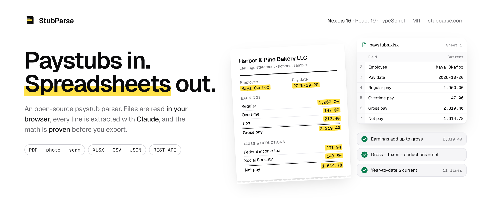
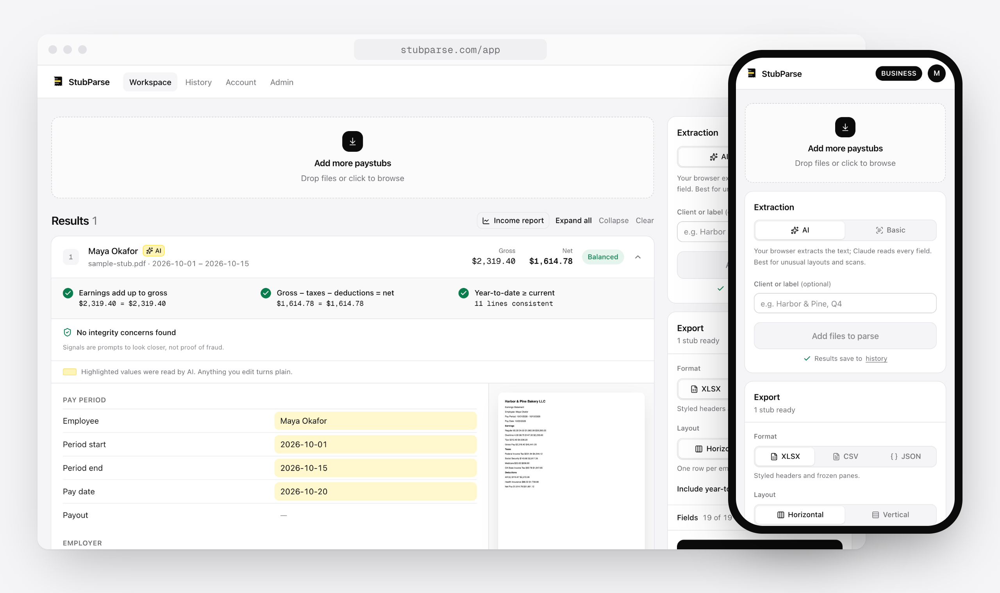
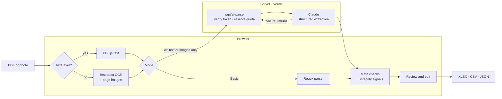
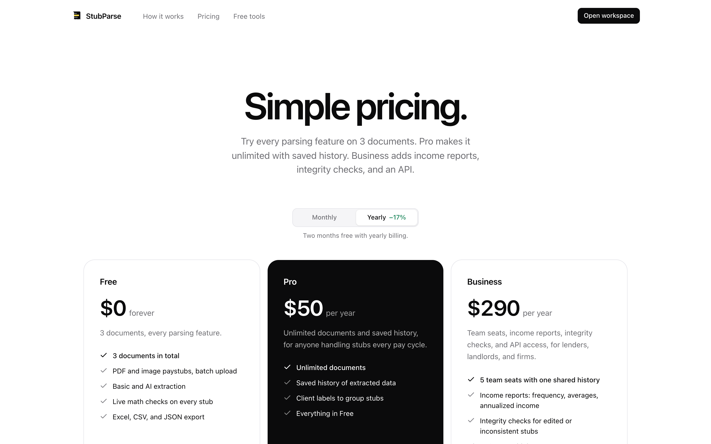
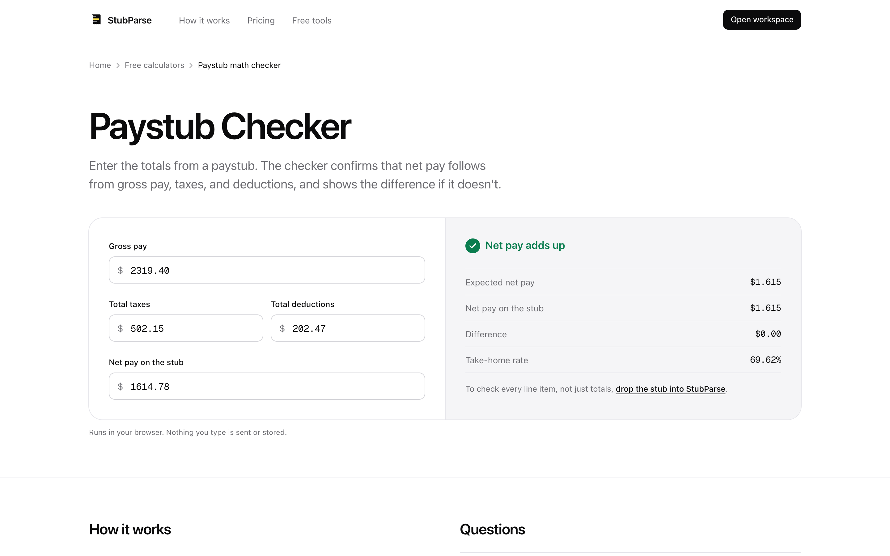
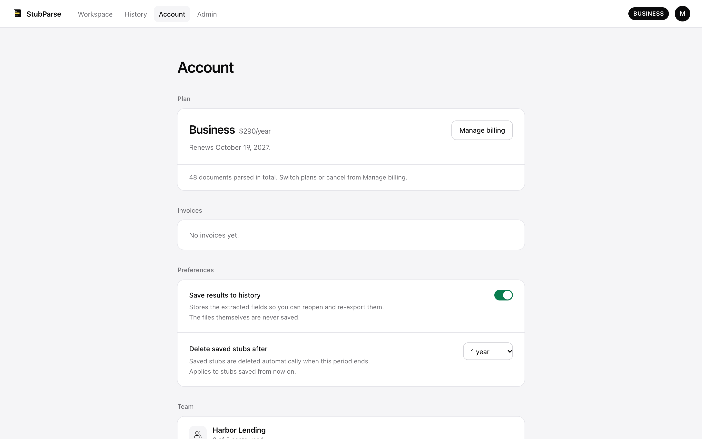

<div align="center">

<picture>
  <source media="(prefers-color-scheme: dark)" srcset=".github/assets/banner-dark.png">
  
</picture>

<br>

**Turn paystub PDFs and photos into clean Excel, CSV, or JSON, with every number checked.**<br>
Open source, private by design, and ready to deploy on Vercel's free plan.

<br>

[](https://github.com/Vitaliqu/stubparse/actions/workflows/ci.yml)
[](LICENSE)
[](https://nextjs.org)
[](tsconfig.json)
[](https://www.anthropic.com/claude)

[**Live app**](https://stubparse.com) &nbsp;·&nbsp; [Architecture](docs/ARCHITECTURE.md) &nbsp;·&nbsp; [REST API](https://stubparse.com/docs/api) &nbsp;·&nbsp; [Self-host](#quick-start) &nbsp;·&nbsp; [Contributing](CONTRIBUTING.md)

</div>

<br>

<picture>
  <source media="(prefers-color-scheme: dark)" srcset=".github/assets/showcase-dark.png">
  
</picture>

## Why StubParse

Bookkeepers re-type paystubs every pay cycle. Loan officers and landlords check income across a stack of them. Everyone ends up copying numbers by hand, and nobody can be sure those numbers add up.

StubParse reads the stub, **proves the arithmetic**, and gives you a spreadsheet:

- **Your file never leaves the browser.** PDF.js and Tesseract run on your device. AI mode sends only the extracted text, or downscaled page images when a scan has no text. Nothing is stored unless you turn on history.
- **Every number is checked.** Earnings must add up to gross, gross minus taxes and deductions must equal net, and year-to-date must be at least the current amount. A stub that doesn't balance says so before you export.
- **What the AI read is visible.** Values Claude extracted are highlighted like a marker on paper. Anything you edit turns plain, so you always know what was read and what was typed.
- **Built for batches.** Drop a stack of stubs, fix what needs fixing, and export one sheet: one row per stub, or one row per employee with pay periods side by side.

## Features

<table>
<tr>
<td width="50%" valign="top">

### Extraction
- **Two modes:** a rule-based parser that runs entirely in the browser, or Claude for unusual layouts and scans
- Multi-page PDFs, photos, and scans (PDF, PNG, JPG, WEBP, BMP, TIFF)
- Handles Gusto, ADP, Paychex, QuickBooks, Square, and generic formats
- Earnings, taxes, and deductions found dynamically, not from a fixed template

</td>
<td width="50%" valign="top">

### Verification
- Three live math checks on every stub
- **Integrity signals:** files saved by editing tools, mixed fonts in amounts, impossible dates, out-of-range tax rates, and YTD jumps between stubs
- Income report: pay frequency, averages, and annualized income across a set of stubs

</td>
</tr>
<tr>
<td valign="top">

### Product
- Firebase Auth: Google, Apple, email + password, magic link
- Stripe subscriptions: Free (3 docs), Pro, Business, monthly or yearly
- Saved history with labels and a retention period you choose
- **Teams:** 5 seats, invite links, shared history
- REST API with hashed keys for Business

</td>
<td valign="top">

### Platform
- Programmatic SEO: provider, format, use-case, and glossary pages, free calculators, JSON-LD, per-page OG images, `llms.txt`
- Lifecycle email (Resend), product analytics (PostHog), error tracking (Sentry)
- Vercel Cron for email and retention cleanup
- Internal admin console with an audit log

</td>
</tr>
</table>

## How it works



Billing, teams, and metering are covered in **[docs/ARCHITECTURE.md](docs/ARCHITECTURE.md)**.

## Engineering highlights

The parts that were hardest to get right.

| | |
|---|---|
| **Billing that self-heals** | Webhooks are deduplicated by event id, then the server **re-reads the customer's subscriptions from Stripe** rather than trusting the payload. Retries, out-of-order delivery, or a missed webhook can't leave a paying user on Free. |
| **Metering that can't be raced** | AI usage is reserved atomically in a Firestore transaction *before* Claude is called and refunded if extraction fails. Parallel requests can't overspend a plan, and the daily limits hold across every serverless instance. |
| **Privacy as architecture** | Text extraction and OCR run in the browser. The server sees text, or downscaled images when there is no text. Sentry strips request bodies and AI payloads, and PostHog masks all text. |
| **Locked-down by default** | A strict CSP (an end-to-end test fails on any violation), HSTS, Firebase App Check, Firestore rules that check the plan, API keys stored only as SHA-256 hashes, HMAC-signed unsubscribe links, and 0 known production vulnerabilities. |
| **SEO as a system** | Data-driven pages, hub pages, breadcrumbs, JSON-LD, and generated OG images. A crawler script checks every sitemap URL for canonicals, structured data, and broken links in CI. |
| **Tested end to end** | Vitest unit tests for the math, income, integrity, billing, and team logic. Playwright runs against the production build, and an optional journey test signs up, parses a stub, and pays with Stripe test mode. A field-accuracy benchmark guards the parser. |

## Tech stack

| Layer | Choice |
|---|---|
| Framework | [Next.js 16](https://nextjs.org) App Router, React 19, TypeScript (strict) |
| Styling | Tailwind CSS 4, Geist, a documented design system ([DESIGN.md](DESIGN.md)) |
| Parsing | [PDF.js](https://mozilla.github.io/pdf.js/), [Tesseract.js](https://tesseract.projectnaptha.com/), [Claude](https://www.anthropic.com/claude) via `@anthropic-ai/sdk` |
| Auth & data | Firebase Authentication, Cloud Firestore, App Check |
| Payments | Stripe Checkout, Customer Portal, webhooks |
| Ops | Vercel (Cron, serverless), Sentry, PostHog, Resend, Upstash rate limiting |
| Quality | Vitest, Playwright, ESLint, GitHub Actions |

## Quick start

**Requirements:** Node 20+, plus a Firebase project, a Stripe account (test mode is fine), and an Anthropic API key.

```bash
git clone https://github.com/Vitaliqu/stubparse.git
cd stubparse
npm install
cp .env.example .env    # fill in Firebase, Stripe, and Anthropic
npm run dev             # http://localhost:3000
```

Basic mode needs only the Firebase variables. AI mode needs `ANTHROPIC_API_KEY`, and paid plans need the Stripe variables. Every optional service (Sentry, PostHog, Resend, Upstash) turns off cleanly when its key is missing.

**Deploy your own:**

[](https://vercel.com/new/clone?repository-url=https%3A%2F%2Fgithub.com%2FVitaliqu%2Fstubparse&env=NEXT_PUBLIC_FIREBASE_API_KEY,NEXT_PUBLIC_FIREBASE_AUTH_DOMAIN,NEXT_PUBLIC_FIREBASE_PROJECT_ID,NEXT_PUBLIC_FIREBASE_APP_ID,FIREBASE_PROJECT_ID,FIREBASE_CLIENT_EMAIL,FIREBASE_PRIVATE_KEY,ANTHROPIC_API_KEY&envDescription=Firebase%20and%20Anthropic%20keys.%20See%20.env.example%20for%20the%20rest.&envLink=https%3A%2F%2Fgithub.com%2FVitaliqu%2Fstubparse%2Fblob%2Fmain%2F.env.example)

Then deploy the Firestore rules (`npm run deploy:rules`) and follow **[LAUNCH.md](LAUNCH.md)** for Stripe, domains, and email.

## REST API

Business accounts can parse stubs from their own systems:

```bash
curl https://stubparse.com/api/v1/parse \
  -H "Authorization: Bearer $STUBPARSE_KEY" \
  -F "file=@paystub.pdf"
```

The response holds the structured fields, the three math checks, and the integrity signals. Full reference: **[stubparse.com/docs/api](https://stubparse.com/docs/api)**.

## Scripts

| Command | What it does |
|---|---|
| `npm run dev` | Start the dev server |
| `npm test` | Unit tests: math checks, income, integrity, billing, teams, calculators |
| `npm run bench` | Field-accuracy benchmark on `bench/fixtures` (`BENCH_AI=1` adds AI mode) |
| `npm run test:e2e` | Playwright against the production build |
| `npm run lint` · `npm run typecheck` | Static checks |
| `npm run build` | Production build |

Local Stripe webhooks, Firestore rules and indexes, and the journey test are covered in **[docs/DEVELOPMENT.md](docs/DEVELOPMENT.md)**.

## More screenshots

<table>
<tr>
<td width="33%"></td>
<td width="33%"></td>
<td width="33%"></td>
</tr>
<tr>
<td align="center"><sub>Pricing</sub></td>
<td align="center"><sub>Free calculators</sub></td>
<td align="center"><sub>Account and team</sub></td>
</tr>
</table>

<sub>All data in screenshots is fictional.</sub>

## Documentation

| | |
|---|---|
| [docs/ARCHITECTURE.md](docs/ARCHITECTURE.md) | Source layout, data model, billing, teams, metering, retention |
| [docs/DEVELOPMENT.md](docs/DEVELOPMENT.md) | Local setup, tests, Stripe CLI, Firestore rules |
| [docs/SEO.md](docs/SEO.md) | The programmatic SEO system and how to add pages |
| [LAUNCH.md](LAUNCH.md) | Production checklist |
| [SECURITY.md](SECURITY.md) | Security model, privacy design, reporting a vulnerability |
| [PRODUCT.md](PRODUCT.md) · [DESIGN.md](DESIGN.md) | Product principles and the design system |

## Contributing

Issues and pull requests are welcome. Read **[CONTRIBUTING.md](CONTRIBUTING.md)** first. The most useful contribution is a parser fix for a layout StubParse gets wrong, together with a synthetic benchmark fixture that proves it.

## License

[MIT](LICENSE). Use it, fork it, ship it.

<br>

<div align="center">
<sub>Built with Next.js, Firebase, Stripe, and Claude. If StubParse saved you some typing, a ⭐ helps others find it.</sub>
</div>
